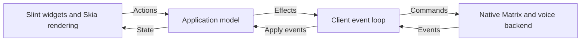

# Application core and client UI

Yapfast's Cargo workspace has four packages, all in one process. The root `yapfast`
package is the executable: the Slint adapter and the command-line entry point.
[`crates/yapfast-core`](../crates/yapfast-core) holds application behavior and the
native Matrix, Discord and voice backend.
[`crates/yapfast-discord`](../crates/yapfast-discord) holds the Discord protocol:
login, the gateway, the HTTP API and voice. [`crates/yapfast-ui`](../crates/yapfast-ui)
compiles `ui/yapfast.slint` and the files it imports in its `build.rs`, so editing
any `.slint` file rebuilds only that crate, and in a
[live-preview build](building.md#seeing-the-app) nothing at all.

## Shared application behavior

[`application.rs`](../crates/yapfast-core/src/application.rs) owns navigation,
remembered channels, per-room drafts, reply and edit modes, delete confirmation,
selected timelines, account and trust status, history loading, call controls and
voice-switch confirmation. The backend saves drafts in the encrypted session
store and sends through the SDK's persistent send queue, which owns retries.
Its local preview uses the same model and emits no network effects.

A client sends an `Action` to `Application::dispatch` and applies backend events
with `Application::apply`. These methods return effects for starting a session
or sending a backend command. `AppState` supplies ordinary Rust data for rendering,
including shared timeline storage through `Arc<Vec<Arc<ChatMessage>>>`, whose
rows a backend sends again unchanged when they didn't change. `dispatch`
routes each action to a method in the module for its area, under
[`application/`](../crates/yapfast-core/src/application): `compose`, `messages`,
`rooms`, `aside`, which shows a Discord thread beside the open channel,
`profiles`, `calls`, `session`, `preview`, `discord_account`,
`header`, which holds what a conversation's header opens: its pins, a search
of a DM or a whole server, and adding friends to a DM, `threads`, a Discord
channel's list of its threads, `server`, which
answers what the account may do in a Discord server and how the server
notifies it, `members`, which builds a server member's menu and carries
out its choices, and `places`, which builds the menus of Discord servers,
categories and channels from those answers.

The Slint adapter in [`src/ui.rs`](../src/ui.rs) and [`src/ui/`](../src/ui), with
the interface in [`ui/*.slint`](../ui), owns input widgets, password masking,
focus, filtering, scroll position, list virtualization, device selectors, window
state, theme and icons. `Adapter::refresh`, in
[`src/ui/refresh.rs`](../src/ui/refresh.rs), shows the application's state one
area at a time: the image viewer, profile, workspace, sidebar, account, header,
member lists, dialogs, composer, messages, the thread beside them and call. `ui/yapfast.slint` holds the
window and imports its parts from the files beside it: the theme, controls, rail,
composer, messages, thread, people, friends, header, voice, dialogs, settings, sign-in and
Discord pieces. The adapter updates widgets after model changes. A programmatic
composer update uses the new room's draft, so it cannot overwrite that draft with
the previous room's text.

Timeline rows retain text, attachment dimensions and message actions for all
loaded history. The timeline ends at the newest message, or is a window of
older messages that doesn't reach it (`AppState::detached`): `Action::Jump`
to a message that isn't loaded sends `Command::Around`, and the backend
shows the messages around it in place of the timeline, answering with
`Event::HistoryLoaded` before the window's `Event::Timeline`, so the
application can leave timelines meant for what showed before.
`Command::Earlier` and `Command::Later` add a page at either end, and each
`Event::HistoryLoaded` says whether the timeline reaches the room's first
message and its newest. `Command::Present` shows the newest again: Discord
keeps them beside the window, following live events, and Matrix rebuilds
its live timeline from the SDK's event cache. Neither loads them again. The UI reports visible item ids, with six rows of margin on
each side, through `Action::VisibleMessages` and `Command::VisibleMessages`.
Discord and Matrix download and decode previews for those items and release
distant decoded handles. Reports are coalesced over 50 ms, reject old rooms,
and refresh when temporary message ids become server event ids even if the
row count stays the same. Discord's recent channels share an 8 MiB LRU cache
of decoded preview pixels; closing a channel clears its own preview handles
and the remembered application's handles. Active rows can hold additional
images outside the cache budget.

Virtualized server, DM, member, friend and message rows carry avatar URLs.
`PictureStore` resolves them only when Slint instantiates their components,
queues missing pictures for one batch, and updates visible bindings when
pictures arrive. Its source registry holds weak pointers. The UI has
yapfast-core decode pictures into Slint's pixel buffers (`set_pixel_buffers`), so
a Slint image of a picture shares its pixels rather than copying them.
Converted avatars and gallery previews share an 8 MiB Slint image cache;
profiles and call controls still request their visible pictures directly. A one-second timer
releases animation decoders and their last frames after they stop being used,
and stops itself when no decoders need checking.

## How a UI change flows through the code

A visible change usually touches each of these steps:

1. **Slint.** A component in `ui/<area>.slint` declares a property or callback.
   Rust sees only `YapfastWindow` in `ui/yapfast.slint` and the structs and globals
   it exports, so `YapfastWindow` declares a matching property or callback and
   binds it to the component. Colours are the exception: components read the
   `Theme` global, which `src/ui/theme.rs` sets whole. The areas are `theme`, `controls`, `rail`, `composer`, `messages`,
   `people`, `friends`, `header`, `voice`, `dialogs`, `settings`, `sign-in` and
   `discord`.
2. **State to window.** `Adapter::refresh` calls one `show_<area>` method in
   `src/ui/refresh.rs` per area (`show_viewer`, `show_profile`,
   `show_workspace`, `show_sidebar`, `show_account`, `show_header`,
   `show_dm_tools`, `show_members`, `show_dialogs`, `show_composer`, `show_messages`,
   `show_voice`), which sets the window's properties from `AppState`. Message
   rows are built in `src/ui/messages.rs`, profile rows in `src/ui/profile.rs`
   and pictures in `src/ui/pictures.rs`.
3. **Input.** `bind_callbacks` in `src/ui/callbacks.rs` registers an `on_*`
   handler for each window callback. Most turn the input into an `Action` and
   pass it to `Adapter::action` in `src/ui.rs`.
4. **Application.** `Adapter::action` calls `Application::dispatch`, executes
   the returned effects, then refreshes the window. A composer keystroke
   (`SetDraft` or `MentionQuery`) refreshes only the composer. A backend event
   shows only what it can change: who's typing shows only the composer, and
   the call, with who's speaking, only the call's views (`Reach` in
   `src/ui/refresh.rs`). The sidebar is built again only once what it shows
   changed. `Action` and
   `dispatch` are in `crates/yapfast-core/src/application.rs`, which routes each
   action to the module for its area in `crates/yapfast-core/src/application/`:
   `compose.rs`, `messages.rs`, `rooms.rs`, `profiles.rs`, `calls.rs`,
   `session.rs`, `preview.rs`, `discord_account.rs`, `header.rs`,
   `threads.rs`, `server.rs`, `members.rs` or `places.rs`.
5. **Backend.** An `Effect::Backend(Command)` goes through `Backend::send` to
   the chat actor in `crates/yapfast-core/src/chat.rs`, which routes it to the
   network its room id names, or to voice. Matrix lives
   in `matrix_chat.rs` and `matrix_voice.rs`; Discord in `discord.rs`,
   `discord_text.rs` with its modules in `discord_text/`, `discord_voice.rs`,
   `discord_audio.rs` and `discord_link.rs`, all under
   `crates/yapfast-core/src/`. The Discord protocol itself is in
   `crates/yapfast-discord`: Yapfast holds the handle in `src/service.rs`, the
   gateway session and its state machines are in `src/service/`, and
   `src/event.rs` names the gateway's events. Backend events come back
   through `Application::apply`.

Yapfast's own sound outside LiveKit's calls goes through
[`audio_io.rs`](../crates/yapfast-core/src/audio_io.rs): Discord voice, the input
meter, ringing, Yapfast's sounds, a watched stream's or a video's sound, and what
other applications play for Go Live. It opens a microphone or speakers by the
device id LiveKit lists, `None` being the system's default, and reads or writes
on the caller's thread in the caller's own buffers. On Linux that's
PulseAudio, or PipeWire's PulseAudio server; on Windows it's WASAPI in shared
mode, with WebRTC's device ids naming its endpoints; on macOS it's Audio Queue
Services, with WebRTC's device ids naming Core Audio's devices.

Each `ChatRoom` carries its `network` and its `capabilities`, such as
whether its messages can be forwarded or its channels sit under
categories, which its backend sets
([`network.rs`](../crates/yapfast-core/src/network.rs)). The application and
the UI ask a room for these rather than reading its id; code that holds
only an id reads its network with `Network::of`.

## Native backend ownership

[`backend.rs`](../crates/yapfast-core/src/backend.rs) starts the chat actor and owns
its command sender, background task and runtime reference. The client retains
this handle for the session, independently of the selected text or voice channel.
Incoming events arrive through a Tokio receiver, so each UI framework can choose
how to wake its event loop.

Slint waits asynchronously on that receiver and updates presentation on its UI
thread. No timer polls the network or redraws an idle window. The adapter retains
one backend across navigation and cancels its event receiver before releasing
the backend. Widget models update changed rows instead of replacing every list
on voice or sync events.

The actor owns one Matrix session and its sync service. The voice controller
leases that same client and encrypted store. Encryption and device trust checks
remain authoritative in the backend. Explicit logout stops voice and sync before
revoking the session; failed logout retains the account. Dropping the backend on
the client thread cancels its work without revoking saved credentials.

The core has no GPUI or other UI-framework dependency. Its native services still
depend on Tokio, SQLite, OS credential storage and libwebrtc. A browser client
will need platform implementations for those services. This split shares app
behavior without claiming the native backend already runs on the web or Android.

## Adding another native UI

1. Depend on `yapfast-core` and render its `AppState`.
2. Dispatch user actions and execute returned effects. For a start effect, retain
   the `Backend` handle and receive its events. For a command effect, call `send`.
3. Feed rejected commands to `Application::backend_failed` and closed event streams
   to `Application::stopped`, then render the updated state.
4. Keep widget-specific work in the client. `selection_version` identifies a room
   change or re-selection; `reset_version` identifies a return to sign-in. Compare
   timeline `Arc` identities to detect timeline replacement without copying it.

Framework experiments can use the shared preview first and connect to the same
native backend afterward. They must preserve the model's behavior rather than
implement their own drafts, send handling or voice lifecycle.

## Checks and packaging

`cargo run --locked` and `--preview` keep their existing behavior. The headless
variant uses `--no-default-features --features matrix,discord`. `scripts/check`
checks the whole workspace; see [building](building.md#checks). Ignored chat and
voice tests now belong to `yapfast-core`, so select them with
`cargo test -p yapfast-core`.

The Windows source archive includes `crates/` and `ui/`. Existing session storage paths and
formats are unchanged. Library tests keep disposable fixtures under the workspace's
ignored `.local` directory even though Cargo runs them from the crate directory.

Validation on 2026-10-02 passed formatting, workspace Clippy with warnings denied,
15 unit tests, a desktop build, and desktop/headless smoke checks. The local
Matrix integration test passed encrypted delivery, session restoration, safe
retries, trust restrictions and channel updates. `scripts/test-voice --fast`
passed native encrypted audio, mute/deafen, late joining, departure and stalled
join cancellation through isolated virtual audio devices. A dependency-tree
check found no UI-framework dependencies in `yapfast-core`.

The Windows x64 MSVC compilation check passed for both workspace packages and
all targets using `cargo xwin check` with `--locked --workspace --all-targets`
and target `x86_64-pc-windows-msvc`. This checks compilation; the refactored
executable has not yet had a Windows runtime test.

The GPUI preview opened and sent a local message with Enter. Future GUI trials
must use an isolated display as described in the comparison plan.

The 2026-10-03 [Slint validation](slint-client.md) passed the complete Linux check
script, 3 desktop tests in addition to the 15 core tests, and a separate encrypted
chat integration test. Private GPU/software UI fixtures passed real encrypted
sending, close, session restoration and logout. Current Windows evidence and
remaining manual checks are recorded in the [Windows guide](windows-beta.md).
